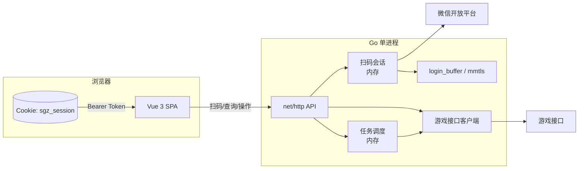

# 架构与设计

本文说明「滑滑猫自动闯关助手」的实现方式、数据流与安全边界，供二次开发与代码审计参考。

## 1. 目标与非目标

**目标**

- 用浏览器完成扫码登录，替代「Windows 客户端 + 读取进程内存取 Token」的旧方案；
- 服务端不保存微信账号、登录会话或游戏 Token，降低公开部署的数据泄露风险；
- 单文件部署（Go 二进制内嵌 Vue 前端），离线可用、无外部 CDN；
- 覆盖查分、一键通关、数独、摸鱼、无尽、消消喵、道具、广告记录、排行榜与配置查询。

**非目标**

- 不提供账号池、代练、多用户后台或云端存档；
- 不绕过微信/游戏服务端的鉴权，仅复用正常扫码登录得到的凭证；
- 不支持批量操作他人账号。

## 2. 总体架构



- 前端与 API 同源；生产环境建议 HTTPS 反向代理。
- 所有服务端状态都在内存，进程重启后只剩浏览器 Cookie 里的 Token。

## 3. 扫码登录链路

```
open.weixin.qq.com/connect/qrconnect?appid=<host_appid>
  → 轮询 long.open.weixin.qq.com/connect/l/qrconnect 得到 wx_code
  → yybadaccess.3g.qq.com/pc_yyb/pcyyb_oauth 换取 openid / access_token
  → pcyyb_get_wx_login_buffer_auth 换取 login_buffer（微信 PC 会话凭证）
  → mmtls + shortlink 握手 → /cgi-bin/mmbiz-bin/js-login（携带目标小程序 app_id）
  → 目标小程序的 wx.login code（一次性、约 5 分钟）
  → 游戏接口 a=wxlogin 换取 X-Auth-Token（48 hex，长期有效）
```

实现要点：

- `internal/qr` 负责二维码与轮询状态；`internal/protocol` 负责 login_buffer 解析、mmtls 握手与 `js-login`。
- `js-login` 的入参包含 `app_id`，因此同一个微信会话可以为指定小程序签发 code；本项目固定为内置的 `MiniProgramAppID`。
- `login_buffer` 只在 `finishQRLogin` 调用期间使用，换到 Token 后立即清空引用；mmtls 会话缓存仅在内存中短暂保留。

## 4. Token 与状态管理

| 状态 | 存放位置 | 生命周期 |
| --- | --- | --- |
| `X-Auth-Token` | 浏览器 Cookie `sgz_session`（JSON：token/account/savedAt） | 180 天 |
| 微信昵称/openid | 同上（仅用于界面展示） | 同上 |
| `login_buffer`、mmtls 会话 | 服务进程内存 | 换 Token 后丢弃；缓存 30 分钟自然过期 |
| 扫码会话 | 服务进程内存 | 默认 5 分钟，自动回收 |
| 任务进度/日志 | 服务进程内存 | 完成后 30 分钟回收；最多保留 256 条 |
| 任务历史/主题/参数 | 浏览器 localStorage | 仅本机 |

设计约束：

- **Token 只下发一次**：`/api/qr/poll` 在 `confirmed` 时返回 Token 后即标记已下发，重复轮询返回 410。
- **任务归属**：任务保存 Token 的 SHA-256 指纹（不保存原文），`GET /api/jobs/{id}` 必须携带同一 Token，否则 404。
- **进程内上限**：扫码会话 32 个、并发任务 8 个、任务表 256 条，超出返回 429 或淘汰最老任务。

## 5. HTTP 接口

统一 JSON，错误格式 `{"error":"..."}` + 4xx/5xx。除扫码外均需 `Authorization: Bearer <token>`（兼容 `X-Auth-Token`）。

| 方法 | 路径 | 鉴权 | 说明 |
| --- | --- | --- | --- |
| POST | `/api/qr/new` | 无 | 新建扫码会话 → `{id,image,expires_in}` |
| GET | `/api/qr/poll?id=` | 无（id 为随机 128 位能力串） | 扫码状态；`confirmed` 时一次性返回 `session.token` |
| GET | `/api/game/me` | Token | 账号数据 `{user,modes,items}`；Token 失效 → 401 |
| POST | `/api/game/action` | Token | body `{action,params}` → `{job}` |
| GET | `/api/jobs/{id}` | 同一 Token | 任务进度/日志/结果 |
| GET | `/api/app` | 无 | `{app_id,version}` |
| GET | `/api/health` | 无 | `{ok:true}` |

`action` 取值：`clear`、`sudoku`、`fish`、`endless`、`match`、`items`、`adlog`、`rank`、`config`。

前端页面：`/`、`/scan`、`/account`、`/ops`、`/jobs`、`/settings` 均由 SPA 接管；
`/assets/*` 为带内容哈希的构建产物，长期缓存；未知 `/api/*` 返回 404，方法不匹配返回 405。

## 6. 安全设计

| 风险 | 措施 |
| --- | --- |
| 服务端被入侵导致账号泄露 | 不保存账号/Token/微信会话；不写数据库与日志 |
| 任务结果被枚举 | 任务按 Token 指纹隔离；顺序 ID 也无法读取他人任务 |
| 扫码 Token 被重复获取 | 扫码 ID 为 128 位随机数，Token 只下发一次 |
| XSS 窃取 Cookie | 无第三方脚本/CDN；`Content-Security-Policy` 限制脚本来源；`X-Frame-Options: DENY` |
| 资源耗尽 | 扫码会话/并发任务/任务表上限；请求体 1 MiB；HTTP 服务器超时 |
| 明文传输 | 服务本身可跑在 HTTP，但公网部署必须在反向代理上启用 HTTPS |
| 上游密钥硬编码 | 内置默认值可通过 `-secret`/`HHMAPI_SECRET`、`-base-url`/`HHMAPI_BASE_URL` 覆盖 |

其他响应头：`X-Content-Type-Options: nosniff`、`Referrer-Policy: no-referrer`、`Permissions-Policy` 限制设备权限。
Token 存在 JS 可读的 Cookie 中（用于界面展示），因此页面不引入任何远程资源，减少注入面。

## 7. 模块结构

```
cmd/server          服务入口：参数、HTTP 服务器、自动打开浏览器
cmd/probe           调试 CLI：二维码 / login_buffer / code / token 链路自检
internal/qr         微信扫码会话与轮询
internal/protocol   login_buffer 解析、mmtls/shortlink、小程序 js-login
internal/game       游戏接口客户端、HMAC 签名、各玩法批量操作
internal/app        扫码状态机、Token 一次性下发、任务调度、Service 实现
internal/api        HTTP 路由、内嵌前端、SPA fallback、安全响应头
internal/store      SQLite 工具库（仅 cmd/probe 使用，Web 服务不打开数据库）
frontend            Vue 3 + Vue Router + Vite + TypeScript
assets/dist         前端构建产物（go:embed）
deploy              systemd unit 与安装脚本
```

依赖方向：`cmd → app → {qr, protocol, game}`；`api` 只定义接口，不依赖 `app`；`game` 不依赖 Web 层。

## 8. 游戏接口适配

- 所有请求带 `X-Client: mg`；POST 请求额外使用 `X-Ts`、`X-Nonce`、`X-Sign`。
- 签名：`X-Sign = hex(HMAC-SHA256(secret, ts + "." + nonce + "." + bodyJSON))`，签名与发送必须使用同一份字节。
- 主关卡上限 220，数独 200 关，小鱼 40 关；`records[].best_steps` 即该关三星最小步数，可直接复用。
- 所有写操作都有服务端进度校验（只增不减），失败会返回明确错误并记录在任务日志中。

## 9. 前端

- Vue 3 `<script setup>` + TypeScript + 手写设计 tokens，无 UI 框架、无 Tailwind、无外部字体。
- 路由：概览 / 扫码 / 账号 / 操作台 / 任务日志 / 设置；history 模式由服务端 fallback 到 `index.html`。
- 登录态读写集中在 `src/stores/session.ts`：Cookie `sgz_session`、`saveLogin`/`logout`/`loadMe`。
- 任务轮询在 `src/stores/jobs.ts`：创建任务后每秒拉取 `/api/jobs/{id}`，401 时清理本机登录态。

## 10. 测试与 CI

- `go test ./...`：API 路由/错误映射/安全头、任务生命周期与归属、游戏客户端签名与各玩法 payload。
- `pnpm typecheck && pnpm build`：前端类型检查与构建。
- GitHub Actions 同时执行 Go 与前端检查，并用 `git diff --exit-code assets/dist` 防止忘记重新构建内嵌产物。

## 11. 已知限制

- 依赖第三方接口的私有协议与签名常量；上游改动可能导致功能失效，需要重新分析。
- `login_buffer` 会过期，因此无法在服务端长期保存微信会话做“自动续期”；Token 失效后只能重新扫码。
- 任务执行是单进程内存态，服务重启会丢失运行中的任务（已完成的本地历史仍保留在浏览器）。
- 未做多用户账号体系；同一服务可被多人使用，但彼此数据隔离依赖浏览器 Cookie。

## 12. 免责声明

本项目仅用于学习、研究与自己账号的自动化测试。请遵守微信、游戏服务商的服务条款与当地法律法规，
不得用于代练、牟利或操作他人账号；使用风险由使用者自行承担。本项目与腾讯、微信及游戏运营方无关联。
