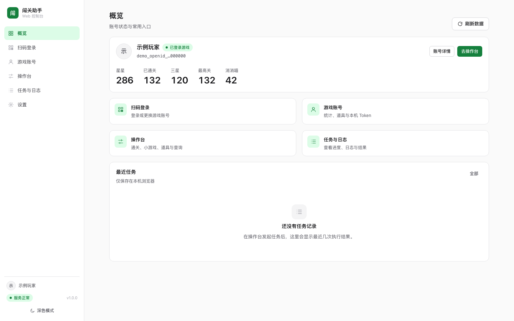
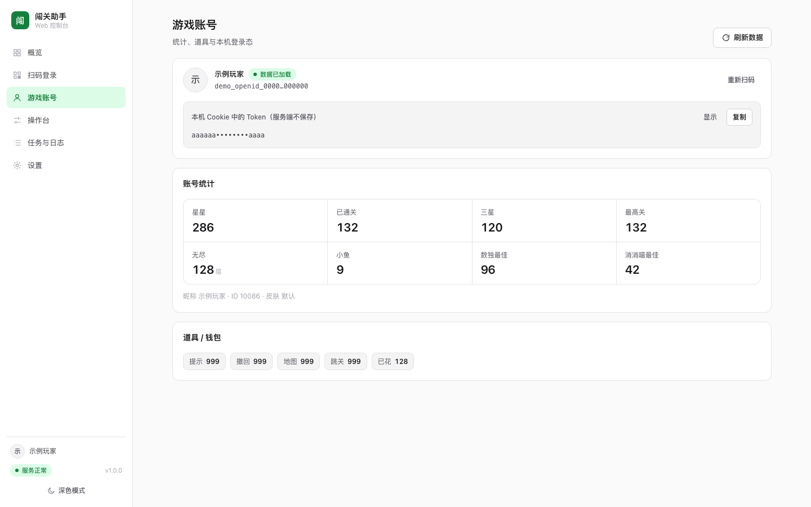
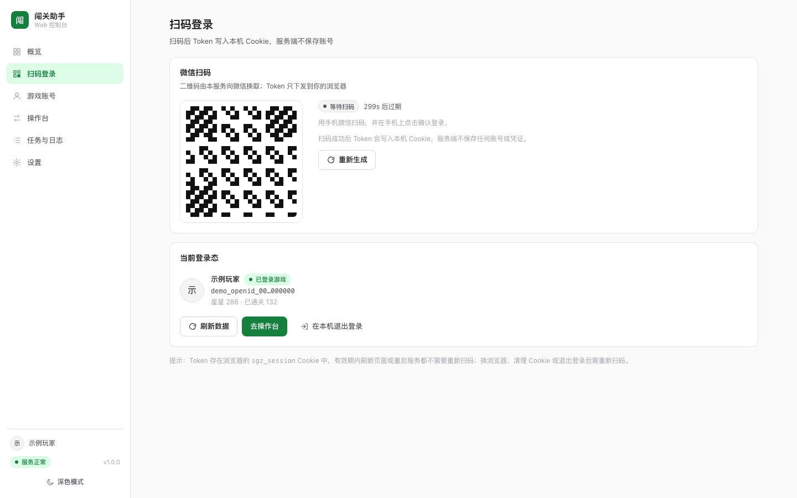
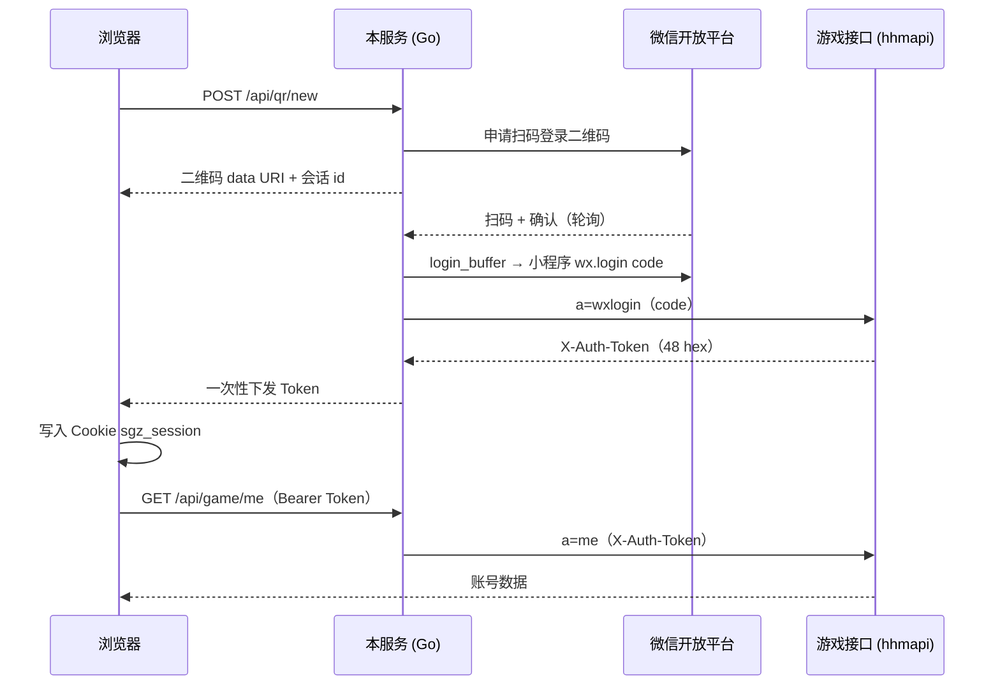

# 滑滑猫自动闯关助手

> 微信小程序《滑滑猫》的 **Web 控制台**：扫码登录 → 查分 → 一键通关 / 数独 / 摸鱼 / 无尽 / 消消喵。
> 单文件 Go 服务 + 内嵌 Vue 前端，**服务端不保存账号与 Token**。

[](https://github.com/kayungou/huahuamao-auto-clear/actions/workflows/ci.yml)
[](https://go.dev/)
[](https://vuejs.org/)
[](LICENSE)



## 特性

- **扫码登录**：手机微信扫码，自动完成 `登录凭证 → 小程序 code → 游戏 Token`，无需安装客户端、不读取进程内存。
- **本机登录态**：Token 写入浏览器 Cookie（`sgz_session`），刷新页面、重启服务都不需要重新扫码。
- **服务端零存储**：不写数据库、不落盘 Token/openid；微信会话只在内存中短暂存在。
- **功能覆盖**：一键通关（1–220 关，自动探测三星步数）、数独喵、摸鱼/小鱼、无尽模式、消消喵、道具补满、广告记录、排行榜与配置查询。
- **任务化执行**：所有写操作在服务端异步执行，前端轮询进度与日志，失败可重试；任务结果只对提交者可见。
- **现代前端**：Vue 3 + Vue Router + Vite，PC/移动端自适应，浅色/深色主题，无 UI 框架、无 CDN、离线可用。

| 账号与 Token | 扫码登录 |
| --- | --- |
|  |  |

## 工作原理



1. 服务端用微信扫码会话换取 `code`，再用 `code` 向游戏接口换取 `X-Auth-Token`。
2. Token 只下发一次，由前端保存到本机 Cookie；服务端立即丢弃微信凭证，**不写数据库**。
3. 后续 `me` / `action` / `jobs` 请求由浏览器携带 Token，服务端只做转发与任务调度。
4. Token 换取后长期有效；换浏览器、清 Cookie 或退出登录后重新扫码即可。

## 安全与隐私

| 数据 | 位置 | 生命周期 |
| --- | --- | --- |
| 游戏 Token、微信昵称/openid | 浏览器 Cookie `sgz_session` | 180 天，换设备/清 Cookie 后重新扫码 |
| 微信 `login_buffer`、mmtls 会话 | 服务进程内存 | 换 Token 后立即丢弃 |
| 任务历史 / 主题 / 默认参数 | 浏览器 localStorage | 仅本机 |
| 服务端数据库 | —— | 不存在（旧版 SQLite 已移除） |

- `/api/jobs/{id}` 需要与提交任务时相同的 Token，避免任务结果被枚举。
- 扫码 Token 只返回一次；扫码会话、并发任务、任务表均有上限。
- 响应头包含 `Content-Security-Policy`、`X-Frame-Options: DENY` 等，降低 XSS/点击劫持风险。
- **Token 等同于账号操作权限**。公网部署请务必使用 HTTPS 反向代理，并考虑 IP 白名单/VPN。

更多细节见 [SECURITY.md](SECURITY.md) 与 [DESIGN.md](DESIGN.md)。

## 快速开始

需要：Go 1.26+（运行）；Node 24 + pnpm 11（仅重新构建前端时需要）。

```bash
# 直接运行（前端产物已内嵌在 assets/dist）
go run ./cmd/server

# 或编译单文件
go build -trimpath -ldflags "-s -w" -o huahuamao ./cmd/server
./huahuamao -host 127.0.0.1 -port 8902
```

浏览器打开 <http://127.0.0.1:8902/>，用手机微信扫码即可。

### 启动参数

| 参数 | 默认 | 说明 |
| --- | --- | --- |
| `-host` | `127.0.0.1` | 监听地址；局域网/公网用 `0.0.0.0` |
| `-port` | `8902` | 监听端口 |
| `-open` | `true` | 启动后自动打开浏览器 |
| `-tcp-proxy` | 空 | `socks5://host:port` 或 `http-connect://host:port`，访问微信服务慢时使用 |
| `-secret` | 内置 | 游戏接口签名密钥；也可用环境变量 `HHMAPI_SECRET` |
| `-base-url` | 内置 | 游戏接口地址；也可用环境变量 `HHMAPI_BASE_URL` |
| `-db` | 空 | 已弃用，仅为兼容旧启动参数保留 |

### 前端开发

```bash
cd frontend
pnpm install
pnpm dev        # http://127.0.0.1:5173/，/api 代理到本机 8902
pnpm build      # 类型检查 + 构建到 ../assets/dist（会被 go:embed 打进二进制）
```

### 部署到 Linux（systemd）

```bash
CGO_ENABLED=0 GOOS=linux GOARCH=amd64 \
  go build -trimpath -ldflags "-s -w" -o sgz-web-linux-amd64 ./cmd/server

scp sgz-web-linux-amd64 deploy/sgz-web.service deploy/install.sh user@server:/root/deploy/
ssh user@server 'cd /root/deploy && sudo bash install.sh ./sgz-web-linux-amd64'
```

推荐在前面放一层 HTTPS 反向代理（Caddy 示例）：

```caddyfile
assistant.example.com {
    reverse_proxy 127.0.0.1:8902
}
```

## 测试

```bash
go build ./... && go vet ./... && go test ./...
cd frontend && pnpm typecheck && pnpm build
```

CI 会同时检查 Go 与前端，并校验 `assets/dist` 与源码一致（防止忘记重新构建）。

## 项目结构

```
cmd/server/          HTTP 服务入口
cmd/probe/           调试 CLI（二维码 / code / token 链路自检，可选）
internal/qr/         微信扫码会话
internal/protocol/   login_buffer、mmtls/shortlink、小程序 code
internal/game/       游戏接口客户端、HMAC 签名、各玩法批量操作
internal/app/        扫码状态机、Token 一次性下发、任务调度
internal/api/        HTTP 路由 + 内嵌前端 + SPA fallback
internal/store/      SQLite 工具库（仅 cmd/probe 使用，Web 服务不打开）
frontend/            Vue 3 + Vite 源码
assets/dist/         前端构建产物（go:embed）
deploy/              systemd unit 与安装脚本
```

## 常见问题

**扫码后提示“换取 Token 失败”**：多为上游接口/网络问题；可配置 `-tcp-proxy` 或稍后重扫。

**二维码一直不显示**：服务端需要访问 `open.weixin.qq.com` 等微信域名；检查网络或代理。

**重启服务后要重新扫码吗？** 不需要。Token 在浏览器 Cookie 中，服务端无状态。

**多人共用一个服务可以吗？** 可以。每个人登录自己的微信，Token 各自保存在各自浏览器；服务端不共享账号数据。

## 免责声明

本项目仅用于**学习、研究与自己的测试账号**，用于理解微信扫码登录与 Web 端自动化。
请遵守微信、游戏服务商的服务条款及当地法律法规；不得用于代练、牟利、批量操作他人账号或任何破坏性用途。
使用本工具产生的账号风险（包括但不限于封号、数据异常）由使用者自行承担。
本项目与腾讯、微信及游戏运营方无任何关联。

## License

[MIT](LICENSE)
